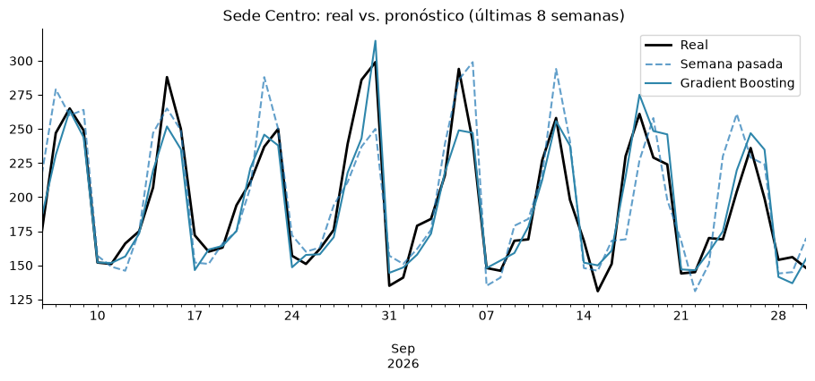
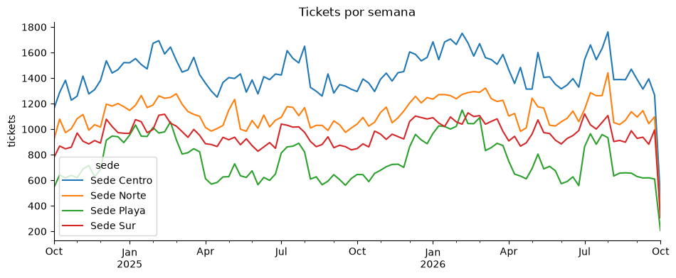

# Pronóstico de demanda por sede

**¿Cuántos tickets va a vender cada sede la próxima semana?**

Con esa respuesta se programa mejor al personal y se compra el insumo justo. Hoy suele decidirse "a ojo", con lo que se vendió la semana pasada. Este proyecto compara ese método contra un modelo de machine learning.

> Los datos son **ficticios**: dos años de ventas diarias de 4 sedes de restaurante, generados por `generar_datos.py` con estacionalidad, feriados peruanos y promociones.

## Resultado

Probado con las **últimas 8 semanas**, que el modelo nunca vio durante el entrenamiento:

| Método | Error promedio (tickets/día) | MAPE |
|---|---|---|
| Usar lo de la semana pasada | 15.7 | 10.9 % |
| Promedio de las últimas 4 semanas | 17.1 | 13.0 % |
| **Gradient Boosting** | **10.7** | **7.6 %** |

El modelo **reduce el error en 32 %** frente a usar la semana pasada, y mejora en las 4 sedes.



## Qué hay en el notebook

[`pronostico_demanda.ipynb`](pronostico_demanda.ipynb)

1. **Exploración:** tendencia semanal, temporadas, día de la semana y efecto de feriados y promociones.
2. **Variables:** día de la semana, mes, feriado, promoción, ventas de hace 7 y 14 días, promedios móviles y sede. Solo se usa información disponible con una semana de anticipación.
3. **Validación por tiempo:** se entrena con el pasado y se prueba con el futuro, no con una separación al azar.
4. **Comparación** contra dos métodos simples que se usan en la práctica.
5. **Importancia de variables** y conclusiones para la operación.



## Cómo correrlo

```bash
pip install -r requirements.txt
python generar_datos.py     # crea data/ventas_diarias.csv
jupyter notebook pronostico_demanda.ipynb
```

## Tecnologías

Python · pandas · NumPy · scikit-learn · matplotlib · Jupyter

## Próximos pasos

- Probar con datos reales del POS agregados por día y sede
- Agregar clima, eventos y quincenas como variables
- Pronosticar por familia de producto para planificar compras
- Publicar el pronóstico semanal en Power BI
